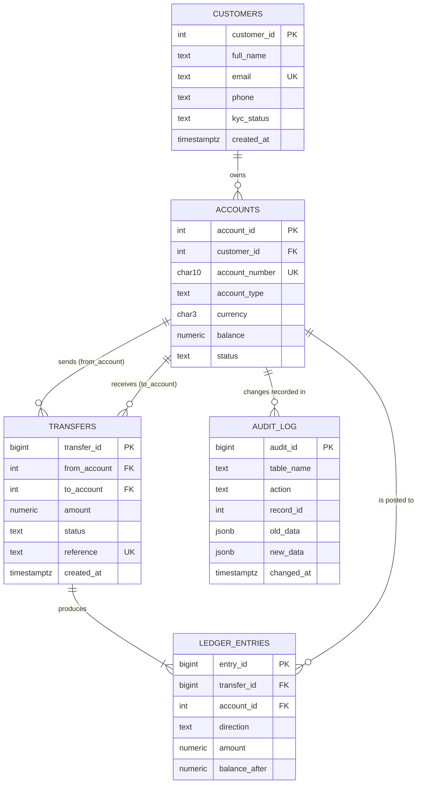
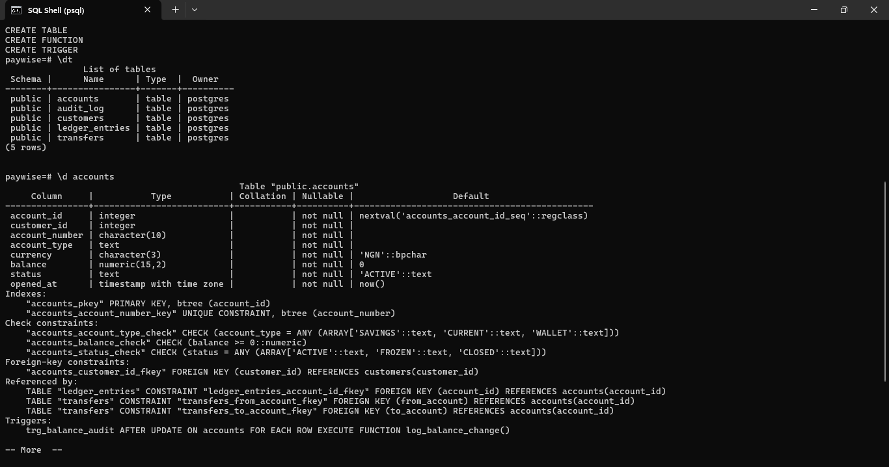
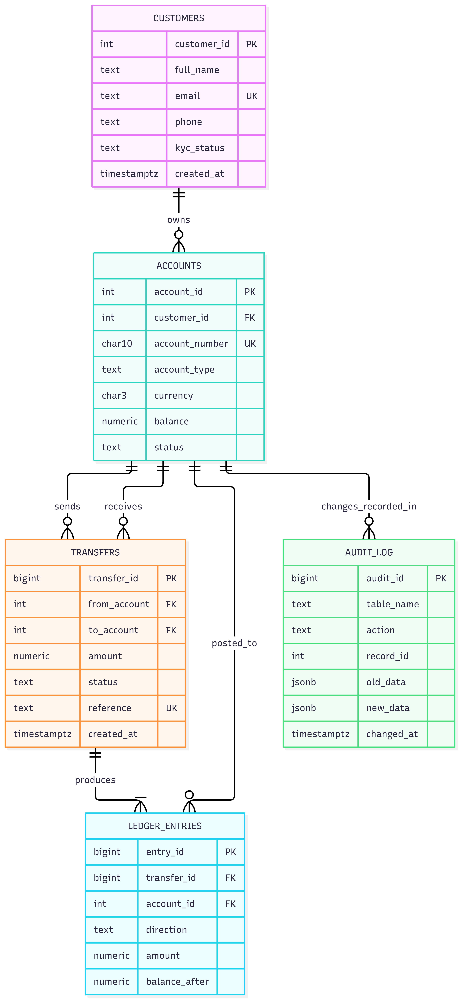

# Portfolio 1: Database Design and Modelling

## Case study statement
- **Organisation:** PayWise, a simulated Nigerian digital bank / fintech platform.
- **Nature of business:** Retail accounts, wallet-to-wallet transfers, deposits and withdrawals.
- **Users of the database:** Customers (via mobile app), customer-support staff, auditors, fraud analysts.
- **Major data stored:** Customers, accounts, transfers, double-entry ledger entries, audit logs.
- **Key operations:** Open account, transfer funds, reverse failed transfers, generate account statement, audit balances, detect suspicious activity.

## ER diagram

## Keys and constraints (see schema.sql)
- **PKs:** surrogate integer keys on every table.
- **FKs:** accounts.customer_id, transfers.from_account/to_account, ledger_entries.transfer_id/account_id.
- **Unique:** customers.email, accounts.account_number, transfers.reference (idempotency: a retried request cannot create a duplicate transfer).
- **CHECK:** balance >= 0, amount > 0, from_account <> to_account, status/type/direction enumerations.
- **Trigger:** every balance change on accounts is written to audit_log.

## Normalisation explanation
- **1NF:** All columns are atomic. No repeating groups (a customer's several accounts live in their own rows in `accounts`, not in a list column).
- **2NF:** All tables use single-column PKs, so no partial dependencies are possible.
- **3NF:** Non-key attributes depend only on the key. Customer details (name, email, KYC) are stored only in `customers`, not repeated in `accounts` or `transfers`. Transfer details are not duplicated in the ledger beyond the amount posted per account.
- **BCNF:** Every determinant is a candidate key (e.g. email and account_number are candidate keys of their tables and also unique).
- **Deliberate denormalisation:** `accounts.balance` and `ledger_entries.balance_after` are derivable from the ledger, but are stored for read performance. Consistency is enforced inside a transaction (Portfolio 3) and can be audited with a reconciliation query.

## Results / evidence
**Tables and the accounts table definition** (`\dt` and `\d accounts`): five tables were created, and the accounts table shows its primary key, unique constraint on account_number, CHECK constraints (balance >= 0, allowed types and statuses), the foreign key to customers, and the balance audit trigger.

**ER diagram:** the five tables and the relationships between them.

